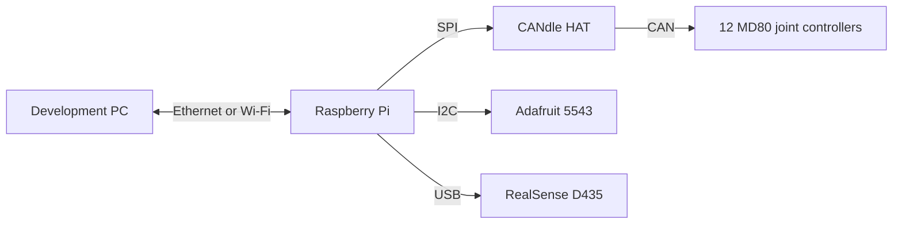

# Hardware reference

Wojtek has a shared body, four legs and twelve actuated joints. ROS selects a
hardware profile; training selects the corresponding model variant. Identify the
physical assembly before choosing either. The full support table is in
[Compatibility](compatibility.md).

## Identify the assembly

| Assembly | Training name | ROS profile | Model |
|---|---|---|---|
| Stock four-bar legs | `wojtek` | `wojtek` | [Stock MJCF](../ros/src/wojtek_description/mujoco/wojtek.xml) |
| Longer v6.27 mechanism | `legs_v627` | `wojtek_v2` | [Variant MJCF](../ros/src/wojtek_description/mujoco/legs_v627/wojtek.xml) |

The [ROS profile](../ros/src/wojtek_policy/wojtek_policy/robots.py) records that
the physical v6.37a legs share v6.27 kinematics. These names are not interchangeable
revision numbers: record the physical part revision alongside the software profile.
Both profiles retain the drive IDs below, but use different joint maps and poses.

For a stock-to-new-leg change, update the mechanical assembly, profile, joint map,
policy and calibration record together. Re-run [commissioning](commissioning.md),
especially the manual joint-sign check. Changing the profile alone cannot verify
the direction or zero of a physical motor.

## Components and connections

| Component | Repository configuration | What to verify on the unit |
|---|---|---|
| Control computer | Raspberry Pi; Ubuntu arm64, ROS 2 Jazzy, RT service | Board model, RAM, OS/kernel and cooling. The repository records Pi 3 tuning and Pi 4/Pi 5 measurements; confirm the installed board. |
| Drive link | CANdle HAT, SPI `/dev/spidev0.0`, CAN at 1 Mbit/s | HAT revision, harness and the baud stored in every drive |
| Joint controllers | Twelve MD80 interfaces, impedance mode | Motor model, controller hardware/firmware and saved motor configuration |
| IMU | Adafruit 5543: LSM6DS3TR-C + LIS3MDL, `/dev/i2c-1` | Board mounting, addresses and calibration |
| Camera | RealSense D435, USB | Camera identity, firmware, cable and measured mount |
| Power | Battery and conversion hardware are not specified in the current build record | Pack, voltage range, protection, converter, wiring and isolation switch |

The communication paths are:

This is a communication diagram. A power schematic and connector-level harness
drawing still need to be supplied; the required information is tracked in the
[hardware evidence register](hardware-evidence.md).

### Joint and CAN ID map

The suffixes `first`, `second`, `third` mean abduction, hip and knee/crank.
On the new legs, the third motor drives the linkage lever rather than a direct
knee joint.

| Leg | Abduction `first` | Hip `second` | Knee/crank `third` |
|---|---:|---:|---:|
| Front left | 10 | 11 | 12 |
| Front right | 20 | 21 | 22 |
| Rear right | 30 | 31 | 32 |
| Rear left | 40 | 41 | 42 |

The [ros2_control description](../ros/src/wojtek_bringup/urdf/wojtek_ros2_control.urdf.xacro)
is the source of this table. Policy actuator order is rear left, rear right,
front right, front left, each with first/second/third. Do not substitute CAN
numeric order for policy order.

### IMU header wiring

Power down before changing wiring. Confirm that the HAT exposes the Pi pins.
These are physical header numbers, with GPIO names shown separately.

| Adafruit 5543 | Pi header | GPIO |
|---|---:|---|
| VIN | 1, 3.3 V | — |
| GND | 9 | — |
| SDA | 3 | GPIO2 |
| SCL | 5 | GPIO3 |

Default addresses are `0x6A` for accel/gyro and `0x1C` for magnetometer; SDO-high
alternatives are `0x6B` and `0x1E`. The driver publishes sensor axes, with the
mount transform applied by consumers. The current mount is yaw −90°: chip +y
points forward and chip +x points right. See
[IMU mount conventions](../ros/src/wojtek_policy/wojtek_policy/imu_mount.py).

Run the [bench checks](../ros/hw_tests/README.md) before ROS commissioning.

### CAN harness

The current launch default is 1 Mbit/s over SPI. SPI does not require an 8M
drive configuration. The project reverted from 8M after connector/termination
faults caused dropped frames and failed flash writes on the assembled harness.
Record both physical termination locations and every drive's stored baud.
Changing baud is a maintenance operation, not part of routine startup.

## Mechanical source and new-leg limits

The repository includes URDF, MJCF and visualization meshes. The mechanical team
exports a `sim_robot` archive; [Robot variants](../training/docs/robots.md)
describes its import and generated collision models. These files do not specify
the full manufacturing process, fasteners or assembly tolerances.

The [2025 thesis](comparative-studies-on-walking-control-algorithms-for-the-quadruped-robot-4barbot.pdf)
is a historical reference for the original body, legs and electronics. It is not
the current new-leg assembly guide.

Known new-leg limits matter during commissioning:

- The documented folded pose uses four 35 mm body standoffs and shins resting
  flat. Its hip target is 2.903 rad; the exported model permits 2.695 rad. The
  actual hip stop needs measurement before the model range is changed.
- Training collision primitives extend below the visible body/thigh. A prior
  lying-pose check used a separate mesh-collision setup, not the committed model.
- The mechanical-team torque value recorded in the variant notes is 22 N·m.
  Runtime torque limits come from the selected policy contract. Neither value
  establishes a measured operating envelope for the complete assembly.

Record physical ranges, clearances and folded geometry in
[hardware evidence](hardware-evidence.md). Do not force a joint to match a model
value when the physical stop differs.

## Build and service documents

- [Commissioning](commissioning.md): first installation, replaced drives and leg changes.
- [Maintenance](maintenance.md): inspection, recovery and missing operating limits.
- [MD80 interface](../ros/src/md80_hardware_interface/README.md): drive lifecycle and configuration.
- [Pi image](../ros/deploy/rpi/IMAGE.md) and [network](../ros/deploy/rpi/README.md): software provisioning.
- [Hardware evidence](hardware-evidence.md): the CAD, BOM, power and measurement inputs still required for a complete build pack.
