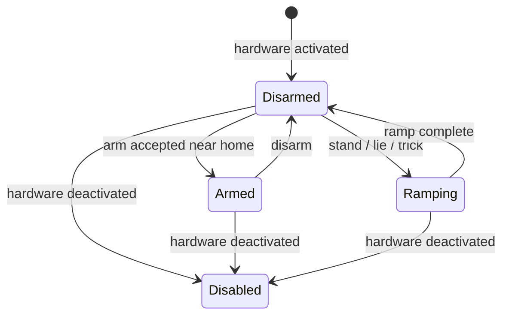

# Operate Wojtek

This runbook covers a commissioned robot and its ROS simulation. For a new build
or changed leg, drive or sensor, complete [hardware commissioning](commissioning.md)
first. Identify the robot and matching policy in [compatibility](compatibility.md).
Commands below run from the repository root unless marked as container or robot.

## Understand the states

| State/action | What it does | What it does not do |
|---|---|---|
| Hardware active | Enables MD80 drives unless `dry_run:=true` | Does not imply policy commands are armed |
| Disarmed | Blocks policy targets in `real_io_node` | Does not remove torque or cancel an existing ramp/trick |
| Armed | Forwards policy targets to the drives | Does not grant exclusive ownership to one command source |
| Policy disabled | Stops policy output through `/wojtek/enable` | Does not disable drives or stop a separate pose ramp |
| Stand/lie/trick | Sends scripted joint targets while disarmed | Service success means started, not completed |
| Navigation cancel | Ends the navigation task/setpoint and stops its velocity output | Does not disarm or remove power |
| Dry-run | Suppresses drive enabling and command output in the hardware path | Is not a measurement of powered behavior |
| Hardware deactivation | Requests drive disable through ros2_control | Is not physical power isolation |
| Motor power removed | Removes the drive supply at the installed isolation point | Does not necessarily turn off the RPi or camera |

A stopped command source causes the policy to read zero velocity after 0.5 s;
height is retained. A stale required sensor instead stops policy target
publication after 0.2 s. Drives may hold their last target. Neither timeout is
an emergency power-off mechanism. The installed power-cut control and procedure
must be confirmed during commissioning.



## Before starting

1. Confirm physical legs, ROS profile and policy agree. The service profile is
   written during provisioning; changing `.env` alone does not change an already
   installed service.
2. With motor power removed, position the robot in its configured boot pose.
   The installed drop-in uses **folded**; a manual launch defaults to **home**.
   Follow the profile's [pose definition](../training/docs/robots.md). The new-leg
   folded pose still has a documented model-range mismatch.
3. Confirm how power will be removed if a powered test must stop. Apply power
   using the commissioned wiring procedure; do not use disarm as a substitute.
4. Connect the operator device to the robot network. Use the
   [network guide](../ros/deploy/rpi/README.md) for cable/AP setup.
5. Choose one command source. Leave other browser drive controls idle and cancel
   an existing autonomy task before driving manually.

Inspect the effective service on the robot:

```bash
systemctl cat wojtek-robot.service
systemctl is-enabled wojtek-robot.service
systemctl status wojtek-cm-watchdog.service --no-pager
```

The repository's installed drop-in enables gamepad, Deck and camera; bags,
telemetry and Foxglove are off. A locally edited service may differ. Boot
startup is enabled only when provisioning used `--enable-robot`.

## Start, zero, stand and drive

For simulation use the [simulation guide](simulation.md). For a physical robot,
enter the PC container and start the service-backed session:

```bash
./ros/dev.sh
# Inside the container:
ros2 run wojtek_bringup robot --web-console --foxglove
```

The wrapper starts the RPi's RT service and local visualization. Launch tokens
and `--policy` do not reconfigure that service; edit/provision its configuration
or deploy the selected policy before the session. A `--dry-run` session is a
separate bench launch and does accept launch overrides.

Open the web console at `http://localhost:8080`, or the Deck panel at
`http://<robot-address>:8090`. In a second container shell:

```bash
ros2 control list_hardware_components
ros2 control list_controllers
ros2 topic echo /wojtek/joint_states_abs --once
```

Expect the selected hardware component and forward position controller to be
active, with joint states arriving. An active controller alone does not prove
that drive communication is healthy; check the service log too.

With the robot physically in the declared boot pose:

```bash
ros2 service call /wojtek/zero std_srvs/srv/Trigger
ros2 service call /wojtek/stand_up std_srvs/srv/Trigger
```

Wait for `stand_up: ramp complete` in the log (default ramp duration: 4 s).
Check that the resulting pose matches the expected home stance. Then:

```bash
ros2 service call /wojtek/arm std_srvs/srv/SetBool '{data: true}'
```

A refusal is a failed precondition, not a reason to increase the limit. Hardware
requires each actuated joint within 0.15 rad of home; simulation uses 0.35 rad.
Inspect zeroing, profile and stand completion if the gate refuses.

Drive from the chosen pad/UI. The launch passes the loaded policy contract to
the robot-paired pad and Deck gateway, so their command and height limits match
the policy. A separately started console may use fallback limits unless given
the same policy reference.

## Pad and Steam Deck

| Control | ROS Xbox pad (`joy`) | Deck panel (`8090`) | Web console (`8080`) |
|---|---|---|---|
| Left stick | Forward/back, yaw | Forward/back, yaw | Forward/back, yaw |
| Right stick horizontal | Strafe | Strafe | Strafe |
| A | Arm toggle | Arm toggle | Arm toggle |
| Y / B | Stand / lie | Stand / lie | Use page buttons |
| Height | Back / Start, −/+ 5 mm | LB / RB, −/+ 5 mm | D-pad down/up, −/+ 5 mm |
| Speed | RB toggles 0.4/0.6 of trained range by default | Right trigger raises 0.5 toward 1.0 of trained range | Page limits and policy contract |
| D-pad | Up paw, left bow, right sit, down shake | Same tricks | Height only |

Stand, lie and tricks require disarmed state. Tricks also require a starting
pose near home. Buttons report service acceptance/refusal; they do not override
these checks. Use one control UI for state-changing operations: arm indicators
track responses and are not a global hardware-state broadcast.

Pair an Xbox pad with the machine running its driver. Linux sim can use
`gamepad:=true`; Docker Desktop on macOS cannot pass the input device, so use a
browser pad there. On the robot, Bluetooth pairing is done once with
`bluetoothctl` (`scan on`, then `pair`, `trust`, `connect` for the selected pad).
The service already starts `joy`/teleop.

For Steam Deck, follow [one-time setup](../ros/deploy/deck/README.md), then:

1. Switch to Desktop and join the operator network.
2. Tap **Deck SSH on** if PC helpers will be used.
3. Tap **Steam off (pad)**, then **Wojtek Panel**, or **Wojtek GO** for both.
4. Check `LINK`, `CAM` and `PAD`; press a button to expose the pad to the browser.
5. Confirm the page is connected to the intended robot or simulation before
   sending commands. The icon prefers a reachable robot over the PC simulation.

## Hand over control

For the default direct command path, stop the current source first. If it is
navigation, send cancel and verify its task/status has stopped:

```bash
ros2 topic pub --once /wojtek/nav/cancel std_msgs/msg/Empty '{}'
ros2 topic info -v /cmd_vel
```

Then release/disable the old manual source and take over with the new one.
Idle ROS pad teleop publishes zeros for two seconds before going quiet, so wait
for that burst to finish. Two active sources can overwrite one another.
In this default mode, disarming alone does not cancel a VLM task; cancel it before rearming for manual
control. See [integration](integration.md) for the command ownership contract.

With `command_mux:=true`, the shared launch routes built-in command sources
through the mux. Manual takeover and disarm cancel navigation and inhibit
autonomy. Resuming requires explicit enable after the manual lease expires,
then a new task. Follow [command ownership](command-ownership.md) and validate
the handover in simulation before using it on hardware. Torque and pose ramps
have the same semantics in both modes.

## Stop and shut down

1. Cancel autonomy if active, release the sticks and verify motion has stopped.
2. Disarm, then request lie-down:

   ```bash
   ros2 service call /wojtek/arm std_srvs/srv/SetBool '{data: false}'
   ros2 service call /wojtek/lie_down std_srvs/srv/Trigger
   ```

3. Wait for `lie_down: ramp complete`. The drives can still hold position.
4. Stop the session with Ctrl-C in the wrapper shell. It stops the robot service
   and local processes. Confirm the service stopped before servicing hardware.
5. Remove motor power and shut down the computer using the commissioned power
   procedure. Physical wiring/power isolation details belong in the hardware
   record; this repository does not yet establish them for every unit.

For a lost drive link, power cycle or failed ramp, use
[troubleshooting](troubleshooting.md). Do not declare the current fallen pose to
be a valid zero just to make the arm gate pass.
