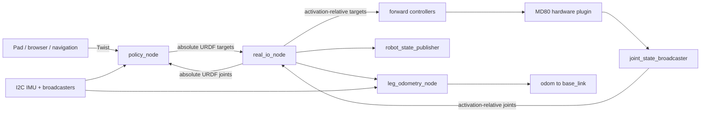
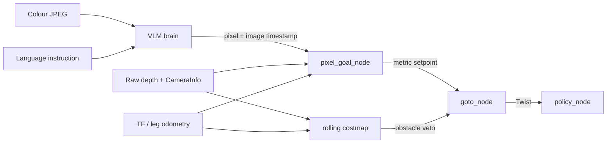

# ROS 2 architecture

Wojtek runs ROS 2 Jazzy. The robot and the PC use CycloneDDS with
`ROS_DOMAIN_ID=42`. The robot runs natively on Ubuntu; development and
visualization run in the PC container. Start with the [documentation home](README.md),
[simulation guide](simulation.md) or [operator runbook](operations.md).

## Machines and processes

| Machine | Responsibilities |
|---|---|
| Robot RPi | MD80/CANdle transport, I2C IMU, ros2_control, policy inference, joint conversion, odometry, gamepad and optional camera/navigation/Deck gateway |
| Development PC | Docker workspace, ROS simulation, RViz/Foxglove, web console and optional VLM brain |
| Model host | Ollama serving the configured vision-language model; may be the PC |
| Steam Deck/browser | Controls and camera display; YOLOX detection runs in the browser |

The service assigns controller and I/O work to core 3, policy and leg odometry
to core 2, and UI, camera and gamepad work to cores 0–1. These are deployment
settings, not properties of ROS. The tree contains Pi 3, Pi 4 and Pi 5 settings
and measurements, including the Pi 4 core budget in `launch_common.py`;
record the actual board and image when comparing performance.

The default direct command path accepts multiple `/cmd_vel` publishers; the
last received message wins. Use one driver at a time. Cancel autonomy before
manual takeover. See [operating states and handover](operations.md).

Shared launches also accept `command_mux:=true` to route built-in writers
through an ownership arbiter. It starts with autonomy inhibited and cancels
navigation on manual takeover or disarm. External writers must use their mux
input. See [command ownership](command-ownership.md) for wiring, enable/resume
steps and validation limits.

## Source of current settings

| Setting | Current configured value | Source |
|---|---|---|
| Controller manager | 100 Hz | `ros/src/wojtek_bringup/config/real_controllers.yaml` |
| Joint and IMU broadcasters | 50 Hz each | Same file |
| Magnetometer broadcaster | 100 Hz | Same file; this does not imply 100 Hz fresh sensor samples |
| Policy | `ctrl_dt` in the loaded contract; normally 50 Hz | `policy_meta.json` |
| CAN transport/baud | SPI CANdle HAT, 1M | `launch_common.py` |
| IMU | I2C LSM6DS3TR-C + LIS3MDL, enabled by default | `wojtek_real.urdf.xacro` |
| Gains and torque limit | Loaded policy contract, unless explicitly overridden | `launch_common.py` |
| Command timeout | 0.5 s; velocity becomes zero, height is retained | `policy_node.py` |
| Required-sensor timeout | 0.2 s; policy stops publishing targets | `policy_node.py` |

The older 400 Hz controller and 8M CAN settings are historical. Never change
hardware baud solely to match an old guide: the configured baud must match the
drives. Actual rates must be measured on the selected board under its intended
camera/telemetry load.

## Coordinates and policy boundary

The model and NumPy policy use the MuJoCo training convention. ROS interfaces use
absolute URDF joint angles, except `/joint_states` and the forward controller
commands, which are relative to drive activation. The profile's joint map handles
signs and offsets between MuJoCo and URDF. `real_io_node` handles the separate
activation offset.

Joint order is rear-left, rear-right, front-right, front-left, each with
first/second/third actuated joints. Consumers should use joint names instead of
assuming message order. The I/O adapter also publishes passive linkage joints for
visualization; those are inferred geometry, not extra encoders.

A robot profile selects legs, joint map, poses, clamp behavior, simulation scene
and policy pin. Training `legs_v627` corresponds to ROS `wojtek_v2`; see the
[compatibility matrix](compatibility.md). A policy for the other robot is refused.
The deployment pair is `policy.npz` and `policy_meta.json`; the robot does not need
JAX or Brax to execute it.

## Main interfaces

| Interface | Type | Meaning |
|---|---|---|
| `/cmd_vel` | `geometry_msgs/Twist` | `linear.x/y`: m/s; `angular.z`: rad/s; positive `linear.z`: stance height in metres for a compatible 4-D policy |
| `/joint_states` | `sensor_msgs/JointState` | Actuated joints in activation-relative URDF convention |
| `/wojtek/joint_states_abs` | `sensor_msgs/JointState` | Absolute URDF joints, plus separate passive-joint messages |
| `/wojtek/joint_targets` | `sensor_msgs/JointState` | Twelve absolute URDF position targets; optional `effort` carries feed-forward torque in N·m |
| `/forward_position_controller/commands` | `std_msgs/Float64MultiArray` | Activation-relative targets in configured joint order |
| `/forward_effort_controller/commands` | `std_msgs/Float64MultiArray` | Optional feed-forward torque for contracts that enable it |
| `/imu_sensor_broadcaster/imu` | `sensor_msgs/Imu` | Sensor-frame IMU; policy and odometry apply the configured mount rotation |
| `/wojtek/arm` | `std_srvs/SetBool` | Open/close the policy-target gate; does not remove drive power |
| `/wojtek/enable` | `std_srvs/SetBool` | Enable/disable policy output; separate from the arm gate |
| `/wojtek/zero` | `std_srvs/Trigger` | Declare the current physical pose to be the configured boot pose |
| `/wojtek/stand_up`, `/wojtek/lie_down` | `std_srvs/Trigger` | Start a pose ramp while disarmed |
| `/wojtek/trick_*` | `std_srvs/Trigger` | Start a supported clip while disarmed and near home |
| `/wojtek/reset` | `std_srvs/Trigger` | Reset policy state; does not reset physics or encoders |

Custom Python joint/command channels normally use reliable, volatile QoS with
depth 10. The mux uses reliable, volatile command subscriptions/output with
depth 1; its status is reliable and transient-local with depth 1.
Navigation status and costmap channels use reliable, transient-local QoS with
depth 1. Camera consumers use sensor-data QoS. Check actual endpoints with
`ros2 topic info -v <topic>` before adding a new subscriber; third-party driver
QoS can differ. The [integration guide](integration.md) covers client behavior.

## Simulation

`robot.launch.py` and `sim.launch.py` share `wojtek_bringup.launch_common`.
Simulation swaps hardware for either `mock_components/GenericSystem` or
`wojtek_mujoco_hardware_interface`. The policy, joint mapping, I/O adapter and
forward controllers remain in the graph.

The MuJoCo plugin preserves activation-relative joints and the IMU mount. It
advances the model by accumulated control-loop time; model timesteps can differ
by robot variant. Its `/sim/qpos` drives a separate Python camera renderer.
Ground truth is published at 100 Hz, including `/odom_vel`, `/sim/rtf` and TF.
Images are stamped when the renderer receives a pose, not at the original
physics tick.

There are deliberate differences:

- The arm displacement limit is **0.15 rad on hardware and 0.35 rad in sim**.
  The simulated plant sags after the stand ramp; passing the sim arm check does
  not prove the hardware check will pass.
- Sim defaults to ground-truth `odom → base_link`. With `leg_odom:=true`, the
  odometry node owns that edge and ground truth moves to `base_link_gt`.
- Physical transport, power, thermal behavior and unmodeled compliance are not
  simulated. Latest-leg folded-pose limits also remain unresolved.

Use the [simulation test contract](sim-test-contract.md) for acceptance checks.
The old `mujoco_sim_node` remains a legacy standalone path and is not launched by
`sim.launch.py`. Restart the current sim launch to reset physics.

## Perception and navigation

The brain runs on a host that can reach Ollama. It verifies a visual target;
`pixel_goal_node` matches the image timestamp to depth and TF; `goto_node` turns
and drives toward the resulting setpoint. The costmap is a rolling local window
in `odom`, not a persistent world map. SLAM is not part of the current launch.
There is no general route planner or established negative-obstacle handling.

On hardware, choose either `deck_camera:=true` or `perception:=true`; enabling
both starts two drivers for one device and is refused. The Deck camera supplies
colour JPEG and raw depth for navigation. The full perception pipeline is a
separate bench path. Mount geometry still needs physical confirmation.

See the [navigation contract](../ros/src/wojtek_nav/README.md),
[camera guide](../ros/src/wojtek_perception_bringup/README.md) and
[odometry guide](../ros/src/wojtek_odometry/README.md).

## Deployment and observation

The installed service drop-in selects the robot profile, folded boot pose,
gamepad, Deck gateway and camera. It disables bags and leaves telemetry and
Foxglove at their default false values. This overrides the base unit, which
contains different flags. Inspect `systemctl cat wojtek-robot.service` on the
robot; the effective unit is the authority.

When requested, `/wojtek/sysinfo` reports computer health and
`/wojtek/policy_timing` reports policy execution and tick intervals. ROS bags
are opt-in. The CM watchdog detects a lost drive link or controller process,
stops the service, and requires a deliberate motor-power cycle before restarting
an enabled service. See [troubleshooting](troubleshooting.md).
