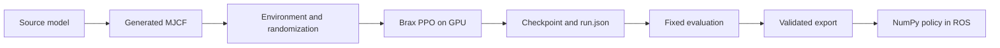

# Train and evaluate a walking policy

Wojtek trains locomotion in MuJoCo MJX with Brax PPO. CUDA training uses
MJWarp; the exported robot policy runs in NumPy without JAX or ROS dependencies.
For operating the robot or testing its ROS stack, start with the
[project guides](../docs/README.md).



The actor receives the selected sensor observations, its previous action and
the command. The critic can use privileged simulation state during training.
Only observations supported on the robot may enter a deployable actor. The
exporter checks the observation contract and compares the deployed computation
with training before writing artifacts.

## Install

Use Python 3.11–3.13 and `uv`. Run these commands from the repository root:

```bash
uv sync --project training --locked --extra dev
./training/run.sh train --cfg job --resolve
./training/run.sh test
```

`uv` creates `training/.venv`; `run.sh` uses that interpreter and changes into
`training/`. Relative run, bag and output paths passed to it are therefore
relative to `training/`, even when invoked from the repository root.

| Host or dependency | Use |
|---|---|
| Linux with a CUDA-compatible NVIDIA GPU/driver | Training and GPU model checks. The Linux dependency set installs JAX CUDA 12 support. Verify that JAX sees the GPU before training. |
| macOS | Configuration inspection, model-free tests, CPU evaluation/export and supported local demos. MJWarp training requires CUDA. |
| CPU-only host | Inspection and selected evaluation tools. CPU training smoke runs compile too slowly to be a useful gate; do not use `run.sh smoke`. |
| `--extra demo` | Browser room demo and VLM client. |
| `--extra room` | Scan download, mesh processing and collision generation. |
| `--extra eval` | Navigation evaluation, including speech dependencies. |
| `--extra sysid` | ROS-free bag reading and actuator identification. |

Repeat `--extra` for each feature you need; include the extras you want to keep
when running `uv sync` again. Use the committed lockfile rather than updating
packages to resolve an installation error. Windows is not a documented host.

```bash
training/.venv/bin/python -c 'import jax; print(jax.devices())'
```

A training host must list a CUDA device. GPU memory use depends on the model,
batch and backend; no minimum VRAM guarantee has been established for every
preset. Reduce the environment count for the first check instead of assuming
a large preset fits. Keep the resulting resolved configuration with the run.

## Choose the robot and build its model

| Physical family | Training variant | Starter experiment | ROS profile |
|---|---|---|---|
| Stock legs | `wojtek` | `locomotion_stiff_v1` | `wojtek` |
| v6.27/v6.37a legs | `legs_v627` | `legs_v627_locomotion` | `wojtek_v2` |

Both starter experiments use encoder-only actor observations supported by the
exporter. The stock recipe is an exportable starting point, not a reproduction
of the current pinned keeper. The new-leg recipe supports flat-ground walking;
read the [variant limits](docs/robots.md#what-does-not-support-a-variant-yet)
before selecting terrain, recovery, jump or biped tasks.

```bash
./training/run.sh build --robot wojtek
./training/run.sh check --robot wojtek --gpu --backend warp --nenv 256 --nsteps 200
```

Use `--robot legs_v627` in both commands for the new legs. Build edits generated
XML, so inspect the diff if the generated models are tracked. Change source
models or the builder rather than editing generated XML by hand.

## Resolve a bounded GPU check

```bash
./training/run.sh train +experiment=locomotion_stiff_v1 \
  run_name=wojtek_pipeline_check seed=1 \
  ++ppo.num_timesteps=1000000 ++ppo.num_envs=1024 \
  ++ppo.batch_size=256 ++ppo.num_minibatches=4 ++ppo.num_evals=2 \
  --cfg job --resolve
```

Inspect the robot, observations, backend, gains and budget. On the GPU host,
repeat that command without `--cfg job --resolve`, with `WANDB_MODE=offline`
set if you do not use online tracking. This exercises training and checkpoint
writing; one million steps is not evidence of a usable walking policy.

For a durable run, use a new run name, an explicit reviewed budget and the
chosen experiment. A preset may override a short default budget; always pin
`++ppo.num_timesteps` for a bounded run. For the new legs, substitute
`+experiment=legs_v627_locomotion`. Training writes
`training/runs/<run_name>/run.json` and checkpoints. Keep the command, seed,
resolved configuration and code revision with those files. Stop with Ctrl-C;
preserve completed checkpoints before starting a new run.

## Evaluate and export

```bash
./training/run.sh report --run runs/wojtek_pipeline_check
./training/run.sh courses --run runs/wojtek_pipeline_check
./training/run.sh eval --run runs/wojtek_pipeline_check --x-vel 0.3
./training/run.sh export --run runs/wojtek_pipeline_check
```

Evaluation reconstructs the robot/configuration from `run.json`. Inspect falls,
tracking, torque, impacts and motion quality, not reward alone. Course scores
for different leg geometries are not directly comparable. Export writes
`deploy/policy.npz` and `deploy/policy_meta.json` under the run. A successful
export proves runtime parity, not walking quality or hardware readiness.

No private keeper access is required to train, evaluate and export your own
policy. To use an existing keeper, configure `HF_ORGANIZATION` and credentials
as described in [the environment template](../.env.example). See
[policy promotion and rollback](docs/policy-lifecycle.md) for local ROS simulation,
artifact provenance and deployment gates.

## When a step fails

| Symptom | Check |
|---|---|
| `.venv/bin/python` missing | Run the install command above; do not use the host interpreter by accident. |
| JAX lists only CPU on the training host | Check the installed driver, CUDA-compatible environment and lockfile installation before running PPO. |
| Out of memory during compilation/rollout | Lower `ppo.num_envs` and compatible batch settings, resolve again, then repeat the bounded check. |
| Policy cannot be restored/exported | Compare robot, actor observation layout and network shape with the checkpoint. An experiment name alone does not establish compatibility. |
| Missing graphics backend | Linux headless tools use EGL; macOS uses its native renderer. Do not force EGL on macOS. |
| Model/checkpoint path missing | Remember that `run.sh` changes the working directory to `training/`. |

Use the [configuration reference](docs/configuration.md) for every supported
setting and command, [demo guide](demo/README.md) for room simulation,
[sysid guide](docs/sysid.md) for actuator fitting, and
[digital-twin workflow](docs/digital-twin.md) for measured model validation.
